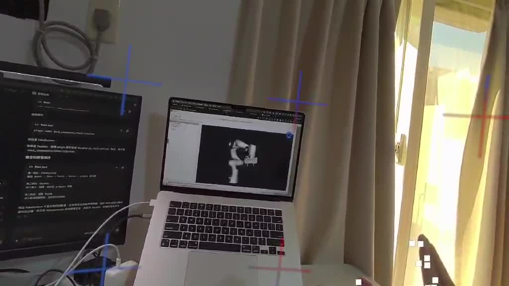

# Quest 3 WebXR Panda Teleoperation

A lightweight browser frontend for controlling a Franka Emika Panda simulation
with Meta Quest 3 hand tracking. Wrist motion is converted into Cartesian pose
targets, while a thumb-and-index pinch controls the gripper.

> This repository contains the WebXR frontend, authenticated WebSocket proxy,
> and reproducible ROS 2 FakeSystem backend configuration.



[Watch the full demonstration (MP4)](docs/demo.mp4)

## System overview

```text
Quest 3 hand tracking
        |
        v
WebXR browser client -- HTTPS/WSS --> Node.js proxy
        |                                  |
        |                                  v
        +----------------------------> rosbridge
                                           |
                                           v
                                   ROS 2 / MoveIt Servo
                                           |
                                           v
                                  Franka Panda simulation
```

The client publishes:

| Topic | Message shape | Purpose |
| --- | --- | --- |
| `/panda_servo/pose_target` | `geometry_msgs/PoseStamped` | Wrist-derived Cartesian target in `panda_link0` |
| `/vr/gripper_cmd` | `std_msgs/Bool` | Pinch state for the gripper |
| `/vr/teleop_enabled` | `std_msgs/Bool` | Teleoperation enable/disable state |

## Features

- Quest 3 immersive AR session with WebXR hand tracking
- Live hand-joint visualization
- First-pose wrist calibration and configurable movement scaling
- Thumb/index pinch detection for gripper commands
- Explicit teleoperation enable/disable controls
- Token-protected WebSocket proxy from `/rosbridge` to local rosbridge on port 9090

## Requirements

- Meta Quest 3 with a WebXR-capable browser
- Node.js 18 or newer
- ROS 2 with `rosbridge_server`
- A MoveIt Servo setup that accepts the topics listed above
- An HTTPS tunnel such as ngrok for Quest WebXR secure-context access

## Quick start

1. Start the ROS 2 simulation, MoveIt Servo, and rosbridge on port `9090`.
2. Generate a temporary token and start the frontend:

   ```sh
   export TELEOP_TOKEN="$(openssl rand -hex 32)"
   node server.js
   ```

3. For desktop inspection, open `http://localhost:8000`.
4. For Quest 3, expose port `8000` through an HTTPS tunnel and open
   `https://<tunnel-host>/#token=<TELEOP_TOKEN>` in the headset browser. Do not
   share or commit the token.
5. Wait for `WS connected`, select **Enable Teleop**, and then select
   **Start WebXR**. The first tracked wrist position becomes the motion origin.

See [RUNBOOK.md](RUNBOOK.md) for the complete development startup, verification,
and shutdown sequence used by the prototype.

## Configuration

The main frontend constants are near the top of `teleop.js`:

- `XR_SESSION_MODE`: WebXR session mode (`immersive-ar`)
- `HAND_POSITION_SCALE`: wrist movement scale

The proxy destination is configured in `server.js` with `ROSBRIDGE_HOST` and
`ROSBRIDGE_PORT`. The server binds to localhost and refuses WebSocket upgrades
unless `TELEOP_TOKEN` matches the browser cookie initialized from the URL
fragment. No tunnel URL or credentials are stored in the repository.

## Safety

This is a research prototype demonstrated with a simulated/FakeSystem robot.
Before using a physical robot, add and validate workspace limits, calibration,
smoothing, velocity/acceleration limits, watchdog behavior, collision checking,
and an independent emergency stop. Always test topic values and coordinate
directions in simulation first.
